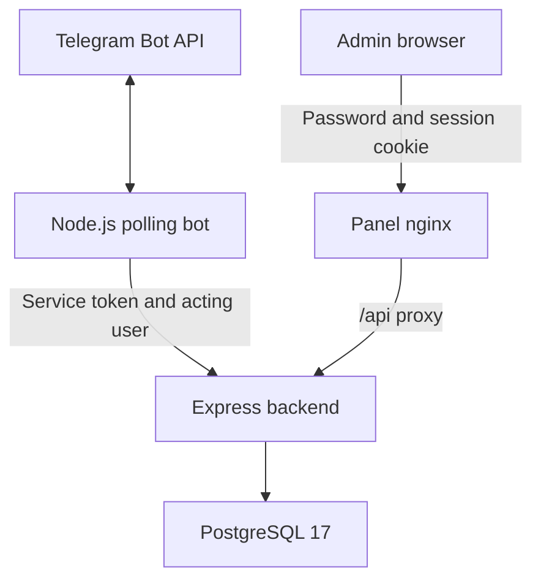

# Architecture

The React/Vite panel is a static SPA with hash-based routes. Production nginx serves its assets and proxies `/api/` to `backend:3000`. In development Vite can call the configured browser-visible API URL directly.

The bot uses `node-telegram-bot-api`, in-memory interaction classes and a `node-cron` reminder task. Its backend client adds a service Bearer token. `AsyncLocalStorage` propagates the Telegram sender ID within one update's asynchronous calls without mixing identities from concurrent users. Scheduled calls have no acting user and can read pending bills only.

The backend runs authentication and authorization before protected routes. Controllers call services and repositories; repositories use parameterized SQL through `pg`. Browser admins have no caller-selected Telegram identity. An actor header is honored only with the bot service credential.

## Data model

| Table | Purpose |
| --- | --- |
| `users` | Telegram identity, profile, admin and allowed flags |
| `banks` | Bank directory and activation/order settings |
| `pix_keys` | PIX value belonging to a user and bank |
| `agenda_payments` | Bill creator, group/topic, due date, total and full-payment status |
| `agenda_payment_members` | Responsible users, allocated share and payment confirmation |
| `bot_installations` | Observed groups/channels and notification topic settings |
| `bot_installation_topics` | Observed forum topics |
| `bot_installation_users` | Recorded user presence in a group/channel |

The canonical schema is `backend/src/db/schema.sql`. Startup applies idempotent DDL in a transaction before listening. It is also mounted for fresh PostgreSQL initialization. There is no versioned migration runner. `CREATE TABLE IF NOT EXISTS` alone does not upgrade existing table definitions.

## State and operational boundaries

PostgreSQL persists bills and registration data. Browser sessions and login throttles live in one backend process, and restart resets both. Multiple backend instances need a shared session/rate-limit store before deployment.

Group membership is inferred from recorded observations, not continuously verified against Telegram. Flows remain process-local and are keyed by actor, chat and topic, with keyboard revision tokens and a 15-minute lifecycle. Reminders use America/Belem dates and scheduling; delivery history is not durable. Remaining limitations are listed in [development](development.md).
